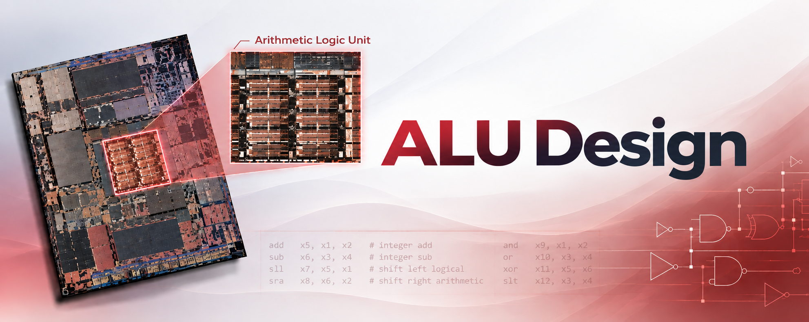

# Design and Implementation of ALUs

- homework for the course "Design and Implementation of Arithmetic Logic Unit" in NSYSU, Taiwan
- **EDA toolchain**: VCS (simulation) → Design Compiler (synthesis) → PrimeTime (STA, power analysis) → Innovus (APR)
- **TSMC N16 ADFP** standard cell library provided through TSRI was used for synthesis.

## Homework

 Hw | Description
--------|:-----
[Hw1][1]| Single-precision Floating-point Adder and Multiplier
[Hw2][2]| IEEE-754 Single-Precision Floating-Point Fused Multiply Adder
[Hw3][3]| IEEE-754 Multi-Precision Floating-Point Dot Product Unit

[1]: hw/HW1/
[2]: hw/HW2/
[3]: hw/HW3/

