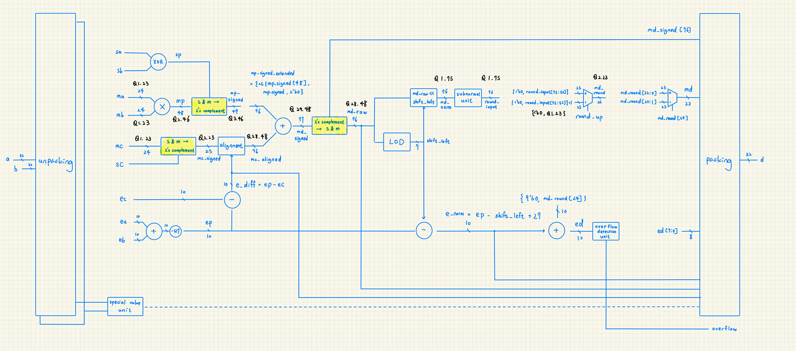
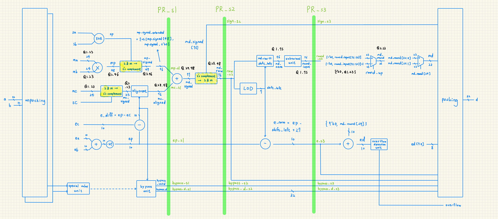
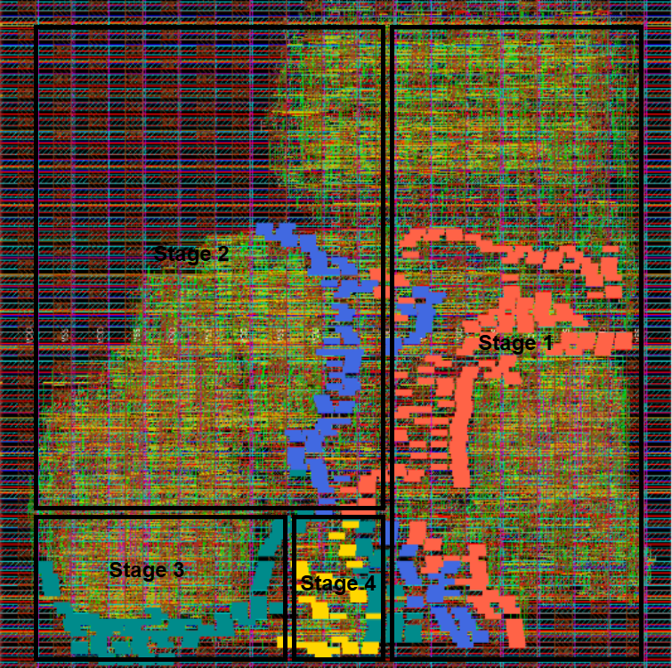
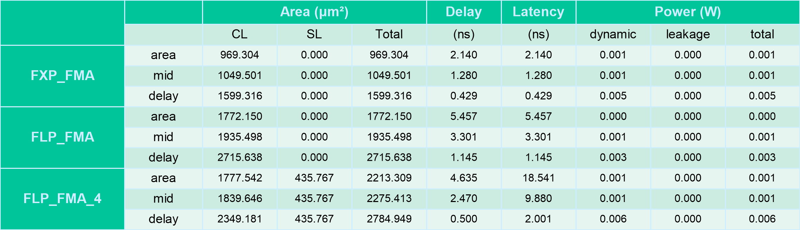

# Hw2. IEEE-754 Single-Precision Floating-Point Fused Multiply Adder

## 1. Introduction

This project implements the fused multiply-add operation, `D = A × B + C`, for IEEE-754 single-precision floating point operands. The multiplication and addition share one normalization and rounding path, retaining the product precision until the final result is rounded. The design follows the [HW2 handout](docs/HW2_handout.pdf) and the [FMA architecture slides](docs/ALU%20HW2_FLP%20FMA.pdf).

Three implementations provide a basis for comparing arithmetic complexity and pipelining:

| Design Directory | RTL Module | Implementation |
|---|---|---|
| `FXP_FMA` | `FXP_FMA` | Combinational signed fixed-point baseline; returns bits `[63:32]` of the 64-bit multiply-add result. |
| `FLP_FMA` | `FMA` | Combinational binary32 FMA with special-value handling and an overflow output. |
| `FLP_FMA_4` | `FMA_pipe` | Four-stage binary32 FMA with registered result and overflow outputs. |

Each design is synthesized under `Area`, `Between`, and `Delay` timing targets. The four-stage implementation also has a separate Cadence Innovus automatic placement-and-routing (APR) flow using the ADFP 16 nm standard-cell technology.

## 2. Methodology

The frontend framework in `scripts/` automates RTL simulation, Design Compiler synthesis, timing-target tuning, SDF-annotated gate-level simulation, and PPA collection for all three designs. The results are collected in [summary.csv](result/summary.csv) and [pipeline_delays.csv](result/pipeline_delays.csv).

Tuning varies the timing constraint while retaining the same synthesis setup:

- **Area:** Start from a relaxed 10 ns target and tighten it using the reported slack.
- **Delay:** Start from an aggressive 0.01 ns target and search for a timing-feasible period.
- **Between:** Start at the midpoint of the selected Area and Delay periods, without tightening below that midpoint.

The search uses slack to update the period and a passing/failing bracket when needed. These selections explore the area–delay tradeoff; they do not guarantee globally optimal implementations.

To reproduce the complete frontend flow, run from `HW2/` in the course server's EDA environment:

```bash
$ bash scripts/run.sh all all
```

For the same flow on the pipeline design alone, or to recollect existing results:

```bash
$ bash scripts/run.sh FLP_FMA_4 all all
$ bash scripts/run.sh collect
```

**Physical design is not yet automated in Hw2.** It is performed separately in Innovus through GUI operations and the Tcl helpers in `FLP_FMA_4/APR/lab_script/`, following the [APR slide deck](docs/ALU_HW2_TA_ADFP_Cell-Based_IC_Physical_Design.pdf). **The two flows use different synthesis Tcl files:** `compile/dc.tcl` produces the comparison results, while [compile_APR/APR_dc.tcl](FLP_FMA_4/compile_APR/APR_dc.tcl) prepares the dedicated APR input set with a 4 ns clock.

See [scripts/README.md](scripts/README.md) for detailed framework usage and [docs/APR_script_guide.md](docs/APR_script_guide.md) for the physical-design script references.

## 3. Microarchitecture Design

Both floating point implementations accept three raw 32-bit binary32 operands and return a raw 32-bit result. The format consists of one sign bit, an 8-bit biased exponent, and a 23-bit fraction. Normal operands restore the hidden leading one; subnormal operands use a leading zero and an effective biased exponent of one.

The overflow indication is exposed as the `overflow` output. It asserts when a finite arithmetic result exceeds the representable range after rounding, and the result becomes signed infinity. An infinity supplied as an input does not itself assert overflow. In the pipeline, `overflow` is registered with the corresponding `d` value.

**Round to nearest, ties to even** is used for the final result. The retained least-significant bit, guard bit, round bit, and sticky information determine whether to increment the significand. Subnormal scaling occurs before this rounding step, allowing gradual underflow and avoiding a second rounding operation.

Special-value handling is implemented in the output priority logic of [FMA.v](FLP_FMA/rtl/FMA.v) and the bypass and output-selection logic of [FMA_pipe.v](FLP_FMA_4/rtl/FMA_pipe.v). The table connects each encoding or exceptional result to those RTL decisions.

| Case | Detection In This Project | FMA Behavior |
|---|---|---|
| Signed Zero | Exponent and fraction are zero; `a_zero`, `b_zero`, and `c_zero` classify either sign. | After NaN and infinity checks, `p_zero` selects `C`. If both the product and `C` are zero, `sp & sc` selects negative zero only when both terms are negative. A zero `C` also forces `mc_aligned` to zero. |
| Subnormal Operand | Exponent is zero and fraction is nonzero. Unpacking sets the effective exponent to one and the hidden significand bit to zero. | `ma`, `mb`, and `mc` enter multiplication and alignment with their actual subnormal magnitude; the operand is not flushed to zero. |
| Signed Infinity | Exponent is `0xFF` and fraction is zero; `a_inf`, `b_inf`, and `c_inf` classify the operands. | A valid infinite product selects `{sp, 8'hff, 23'd0}`. Otherwise, an infinite `C` selects `C`. These input-infinity paths leave `overflow` low. |
| NaN Operand | Exponent is `0xFF` and fraction is nonzero; `a_nan`, `b_nan`, and `c_nan` have highest output priority. | Any NaN operand selects `NAN_RESULT = 32'hffffffff`, matching the supplied golden encoding. The original NaN payload is not propagated. |
| Invalid Arithmetic | `p_invalid` detects zero multiplied by infinity. `p_inf && c_inf && (sp != sc)` detects addition of opposite infinities. | Both cases select `NAN_RESULT` and leave `overflow` low. The interface does not expose a separate invalid-operation flag. |
| Subnormal Or Zero Result | `e_norm <= 0` selects subnormal scaling; `md_raw == 0` detects exact cancellation. The pipeline carries these decisions through `e_s3` and `zero_s3`. | Sticky-preserving shifting precedes ties-to-even rounding. Rounding may produce a subnormal, promote it to the smallest normal value, or produce signed zero. Exact cancellation selects positive zero. |
| Overflow Result | After normal-result rounding, `ed >= 255` selects the overflow branch. | The result becomes infinity with the computed result sign, and `overflow` asserts. In `FMA_pipe`, `d` and `overflow` are registered together in stage 4. |

In `FMA_pipe`, stage 1 captures special-result selections in `bypass_s1` and `bypass_d_s1`. These advance through the stage-2 and stage-3 bypass registers before stage 4 selects the result, preserving the four-stage latency for special values as well as ordinary arithmetic.

### 3.1 FLP FMA

<p align="center"></p>

The combinational implementation is defined in [FLP_FMA/rtl/FMA.v](FLP_FMA/rtl/FMA.v). Its main latency reduction comes from aligning `C` while the significands of `A` and `B` are multiplied. Alignment depends on the exponents, so it can proceed without waiting for the multiplier result.

The unpacking logic generates `sa`, `sb`, `sc`, effective exponents `ea`, `eb`, `ec`, and 24-bit significands `ma`, `mb`, `mc`. The product sign is `sp = sa ^ sb`, the biased product exponent is `ep = ea + eb - 127`, and `e_diff = ep - ec` controls alignment of `C`.

The unsigned 24 × 24 multiplication produces the full 48-bit `mp` in Q2.46 format. Sign conversion produces `mp_signed` in Q3.46, which is sign-extended and given two additional fractional bits to form the 76-bit Q28.48 `mp_signed_extended`. The signed significand of `C` is extended to the same scale before alignment.

For `-25 <= e_diff <= 47`, `mc_extended` is shifted left or arithmetically right as required. Right shifts preserve discarded nonzero information in the sticky bit. If `C` is zero, the aligned contribution is explicitly zero. For a much smaller nonzero `C`, the alignment path retains a signed minimum contribution; when `C` dominates sufficiently, the output control selects `C` directly.

The two signed 76-bit operands are added into the 77-bit `md_signed`. Its sign is retained while its magnitude becomes `md_raw`. A leading-one detector computes `shift_left`, and the normalization shifter produces `md_norm`. The exponent follows the same scaling through `e_norm = ep + 27 - shift_left`.

If the normalized exponent is nonpositive, the subnormal unit shifts the magnitude to the exponent-one scale and preserves sticky information. The rounding logic then uses bit 51 as guard, bit 50 as round, bits `[49:0]` as sticky information, and bit 52 as the retained LSB. A rounding carry updates the significand and exponent. Finally, the priority logic selects a special result, cancellation zero, subnormal result, overflow infinity, or ordinary packed binary32 result. No intermediate binary32 product is rounded before the addition.

**Critical Path:** In the Delay synthesis selection, the worst path runs from `a[1]` to `d[1]` with a reported delay of 1.145 ns. Multiplication feeds the addition, normalization, and rounding logic without intervening registers, so their serial delays accumulate even though `C` alignment runs in parallel with multiplication.

### 3.2 FLP FMA Pipe 4

<p align="center"></p>

The implementation in [FLP_FMA_4/rtl/FMA_pipe.v](FLP_FMA_4/rtl/FMA_pipe.v) partitions the same combinational datapath into four stages. Registers separate multiplication and alignment, signed addition, normalization, and final rounding and packing.

| Stage | Operations | Registered Outputs |
|---|---|---|
| 1 | Unpack and classify operands; compute exponents; multiply significands; align `C`; choose special-value or dominant-`C` bypass data. | `mp_s1`, `mc_s1`, `ep_s1`, `bypass_s1`, `bypass_d_s1` |
| 2 | Add the signed product and aligned addend; convert the sum to sign and magnitude. | `raw_s2`, `sign_s2`, `ep_s2`, `bypass_s2`, `bypass_d_s2` |
| 3 | Detect the leading one, normalize, adjust the exponent, and prepare subnormal rounding input with sticky information. | `round_s3`, `e_s3`, `sign_s3`, `zero_s3`, `bypass_s3`, `bypass_d_s3` |
| 4 | Round once, account for rounding carry, select the final encoding, and detect overflow. | `d`, `overflow` |

The bypass decision is made from the incoming operands in stage 1, then delayed through all three internal register banks. The sign, exponent, and zero indication likewise travel with their associated arithmetic result. This alignment ensures that a special-value result or overflow indication belongs to the same input triple as the output data.

For inputs stable before capture edge 1, stage 1 captures at edge 1, stage 2 at edge 2, stage 3 at edge 3, and the output registers at edge 4. Once filled, the pipeline can accept one input triple and produce one result per clock cycle. There is no valid/ready interface or stall control, so the surrounding logic must track the initial fill interval. Reset is synchronous and active high; it clears the internal state and both outputs on a rising edge.

The synthesis stage boundaries in [compile/stage_paths.tcl](FLP_FMA_4/compile/stage_paths.tcl) follow the actual register banks, allowing each stage's delay to be measured separately.

**Critical Path:** Stage 3 is setup-critical in all three synthesis selections, from `raw_s2` to `round_s3`. Leading-one detection, normalization, and subnormal shifting with sticky-bit generation remain in one stage, making this path longer than the other stage paths; the APR results in Section 6.2.3 identify the same bottleneck.

## 4. Verification

Verification uses the file-driven Verilog testbenches [TB_FXP_FMA.v](FXP_FMA/pre_sim/TB_FXP_FMA.v), [TB_FMA.v](FLP_FMA/pre_sim/TB_FMA.v), and [TB_FMA_pipe.v](FLP_FMA_4/pre_sim/TB_FMA_pipe.v). Each design has matching pre-simulation and post-simulation testbench copies. Inputs are read from `normal/a.txt`, `normal/b.txt`, and `normal/c.txt`; floating point designs additionally read the corresponding `special/` files.

The fixed-point bench checks 200 input triples. Its reference calculation forms a signed 64-bit product, adds the sign-extended and unshifted `C`, and compares the upper 32 bits with the DUT output. The floating point benches check 200 normal triples and 15 special triples against the supplied `ab+c.txt` golden files. Results must match exactly at the bit level, including the expected NaN encoding and signed zeros; an X or Z value also fails the comparison.

The floating point benches verify `overflow` independently: finite inputs with an infinite golden result require overflow to assert. The expected flag is derived from the inputs and golden result rather than the DUT output. Finite values are also converted to Verilog `real` for absolute and relative error diagnostics. Relative error uses the magnitude of the golden result, with explicit handling of a zero denominator. These statistics do not relax the exact pass/fail comparison.

The combinational benches apply an input triple, wait one configured `CYCLE`, and then compare outputs. The pipeline bench asserts reset across two rising edges, drives one triple per falling edge, and samples one time unit after each rising edge. It uses `LATENCY = 4`, begins comparison at the fourth capture edge, and drains the final three results after the last input. Normal and special datasets are reset and reported separately.

Each bench checks the input records, writes the DUT answers and comparison reports, and generates a waveform. A pass requires all expected vectors to complete with zero errors; normal and special cases are reported separately.

Gate-level verification uses the selected synthesized netlist, the standard-cell simulation model, and maximum-delay SDF annotation. The framework checks that annotation completes and rejects annotation errors and timing violations before accepting the result.

The stored summary reports passing RTL and gate-level simulation for all nine selections. These runs check the supplied vectors with a 100 ns checker cycle, independently of the shorter synthesis targets. They establish correctness for those tests rather than exhaustive IEEE-754 compliance or operation at each target period. Post-layout simulation using the APR netlist and SDF remains separate from the automated frontend checks.

## 5. Physical Design

Physical design follows the [ADFP cell-based physical-design slide deck](docs/ALU_HW2_TA_ADFP_Cell-Based_IC_Physical_Design.pdf). The implementation top is `FMA_pipe`, and Innovus is launched from `FLP_FMA_4/APR/`. The design import requires a matched gate-level netlist and SDC, physical LEF libraries, timing libraries, and `mmmc.view.stylus`.

The physical implementation uses the following dedicated APR input set:

| Input | Path | Purpose |
|---|---|---|
| Synthesis Tcl | `FLP_FMA_4/compile_APR/APR_dc.tcl` | Prepares the four-stage design for APR using a 4 ns clock period. |
| Gate-Level Netlist | `FLP_FMA_4/gate_level/SYN/FMA_pipe_syn.v` | Standard-cell connectivity imported into Innovus. |
| Timing Constraints | `FLP_FMA_4/gate_level/SYN/FMA_pipe_syn.sdc` | Matching clock and I/O constraints, prepared according to slide 7. |
| MMMC Setup | `FLP_FMA_4/APR/mmmc.view.stylus` | Defines timing libraries, RC corners, functional constraints, and analysis views. |

`mmmc.view.stylus` selects the SYN SDC listed above. The comparison results in Section 6.1 use `compile/dc.tcl`, while the physical implementation and APR results in Section 6.2 use `compile_APR/APR_dc.tcl` and its matching SYN outputs.

The ADFP physical and timing libraries provide different information for this implementation:

| Library | Files Used In This Project | Role In APR |
|---|---|---|
| **Physical Library (ADFP Process LEF)** | `N16ADFP_APR_Innovus_11M.10a.tlef` and `N16ADFP_StdCell.lef` | Define routing layers, vias, placement sites, cell dimensions, pin geometry, and routing obstructions. Innovus uses these physical abstracts to place and route `FMA_pipe` and check implementation geometry. |
| **Timing Library (ADFP Process LIB)** | The four `N16ADFP_StdCell*_ccs.lib` files selected in `mmmc.view.stylus`. | Provide cell timing arcs, transition and load behavior, setup/hold constraints, and power models at each PVT corner. Innovus uses these models to analyze the placed and routed pipeline. |

The timing LIB files are selected separately through MMMC. Interconnect resistance and capacitance come from the QRC technology files and extraction, complementing the cell timing models in LIB.

### 5.1 Multi Mode Multi Corner

[mmmc.view.stylus](FLP_FMA_4/APR/mmmc.view.stylus) defines the operating conditions used to evaluate `FMA_pipe`. Although the Multi Mode Multi Corner (MMMC) framework supports multiple constraint modes, this project uses one functional mode, `CM_func`, with the 4 ns clock and I/O constraints from `gate_level/SYN/FMA_pipe_syn.sdc`.

The four timing-library sets are combined with the extraction corners as follows. All LIB files are under the ADFP standard-cell `CCS/` directory.

| PVT Corner | Timing Library (LIB) | RC Corner | Active Analysis |
|---|---|---|---|
| SS, 0.72 V, 125 °C | `N16ADFP_StdCellss0p72v125c_ccs.lib` | `RC_worst` | Setup and hold. |
| SS, 0.72 V, −40 °C | `N16ADFP_StdCellss0p72vm40c_ccs.lib` | `RC_worst` | Setup and hold. |
| FF, 0.88 V, 125 °C | `N16ADFP_StdCellff0p88v125c_ccs.lib` | `RC_best` | Hold, dynamic power, and leakage power. |
| FF, 0.88 V, −40 °C | `N16ADFP_StdCellff0p88vm40c_ccs.lib` | `RC_best` | Hold. |

Each delay corner pairs a cell timing condition with an RC corner, and each analysis view combines that delay corner with `CM_func`. Both SS views are active for setup, while all four views are active for hold. This lets the APR timing reports evaluate the same pipeline under different cell and interconnect conditions; Section 6.2 identifies the views responsible for its worst setup and hold paths.

### 5.2 Power Plan

Initialization uses `APR/lab_script/config.tcl` and `config_cts.tcl`. Global-net connections associate VDD and VPP with the supply, VSS and VBB with ground, and tie-high/tie-low functions with the corresponding nets. The recorded floorplan uses aspect ratio 1, target core utilization 0.5, and nominal 80 µm core-to-die margins on each side.

The power plan creates supply rings around the core and distributes VDD and VSS through upper-metal stripes. `APR/lab_script/pns.tcl` provides the ring and stripe procedures. The ring recipe uses M8 for horizontal sides and M7 for vertical sides, followed by M6 horizontal and M5 vertical rings. Both use 2 µm width, 1.1 µm spacing, and interleaved wire groups. Excess ring segments are trimmed after construction.

The upper power mesh adds vertical M9 stripes and alternating horizontal and vertical stripes down through M5, following slides 22–24. VDD and VSS occupy separate conductors. Ring and stripe construction is followed by DRC before the lower-layer power connections are completed.

### 5.3 Power Route

Power routing connects the standard-cell power pins to the rings and mesh. Special Route creates follow-pin rails along the cell rows and generates via connections toward the core rings and stripes, with connections through M5 in the slide recipe.

`APR/lab_script/shrink_via.tcl` adjusts the existing follow-pin VIA12, VIA23, and VIA34 geometries to address the lower-layer spacing conditions discussed in the deck. Additional horizontal M2 stripes are then added with 0.064 µm width and 1.152 µm pitch: VSS starts at 0.544 µm and VDD at −0.032 µm. Special-net connectivity and DRC are checked after completing these connections.

These checks answer different questions:

- **Check DRC:** Design rule checking examines layout geometry, including metal width, spacing, via enclosure, and cut spacing. It identifies geometry that violates the implementation rules.
- **Check Connectivity:** Connectivity checking examines whether the intended net connections are physically complete, identifying problems such as unconnected pins, opens, and unintended connections. At this stage, the check focuses on the VDD/VSS special nets to confirm that the power network reaches the cell power pins.

A power network can satisfy spacing rules while still containing a disconnected rail, so both checks are needed. Connectivity must also be rechecked after via removal or other power-network changes.

The following layer map is adapted from [docs/metal_layer_power_network.md](docs/metal_layer_power_network.md):

| Layer | Power Structure Specified In Deck | Direction / Location |
|---|---|---|
| M11 | No power-ring or stripe assignment in the deck recipe. | Mentioned in helper range assumptions and clock-rule tables. |
| M10 | Upper stacked-via limit for M9 stripes; no power-stripe or ring pattern specified. | A limit does not establish actual metal or via creation. |
| M9 | Paired VDD/VSS power stripes. | Vertical. |
| M8 | Power ring and power stripes. | Ring top/bottom sides; horizontal stripes. |
| M7 | Power ring and power stripes. | Ring left/right sides; vertical stripes. |
| M6 | Power ring and power stripes. | Ring top/bottom sides; horizontal stripes. |
| M5 | Power ring and power stripes. | Ring left/right sides; vertical stripes. |
| M4 | Intermediate metal for via connections; no regular power-stripe pattern specified. | Local connection geometry depends on generated vias. |
| M3 | Intermediate metal for via connections; no regular power-stripe pattern specified. | Local connection geometry depends on generated vias. |
| M2 | Additional VDD/VSS power stripes. | Horizontal. |
| M1 | Follow-pin power rails along standard-cell rows. | Horizontal. |

These assignments describe the deck's power-network recipe; a layer may also carry clock and signal routing. Stacked-via limits permit connections across a range of layers but do not create a stripe on every intervening layer. Electrical continuity must be checked explicitly, since overlapping shapes in a top-down view do not by themselves establish a connection.

### 5.4 Placement

`APR/lab_script/add_well_taps.tcl` inserts **well tap cells** in a checkerboard pattern before standard-cell placement. These cells provide regular connections from the wells and substrate to the appropriate bias supplies, maintaining body potentials and reducing latch-up susceptibility. The recorded run inserted 59 well tap cells. Innovus then places the standard cells and checks placement legality.

Pre-CTS timing analysis guides placement optimization and repairs for capacitance, transition, and fanout violations. Timing is checked again after optimization. General implementation settings come from `APR/lab_script/config.tcl`.

### 5.5 CTS

`APR/lab_script/config_cts.tcl` selects the CKBD buffer and CKND inverter families and defines separate non-default routing rules for clock trunks and leaves. Trunks prefer M6–M7 with VSS configured as the shield net; leaves prefer M4–M5. The transition targets are 150 ps for top/trunk routing and 100 ps for leaves.

Clock concurrent optimization (`ccopt`) implemented the `clk` tree with six buffers serving 467 register clock sinks. The CTS report records 3.784 µm² of clock-buffer area and no inserted clock inverters. At the SS, 0.72 V, 125 °C late corner, insertion delays range from 0.082 to 0.091 ns, with 0.009 ns skew.

The post-CTS reports show setup WNS of 0.074 ns and hold WNS of 0.009 ns, with zero violating paths in both checks. Transition violations remain, as discussed with the APR timing results in Section 6.2.

The post-CTS **tie-high/low cell** insertion step uses the cell choices configured in `APR/lab_script/config.tcl`. The recorded step placed zero tie-high and zero tie-low cells.

### 5.6 Route

Signal routing connects the placed cells through global and detailed routing, followed by wire and via optimization. Timing-driven and signal-integrity-driven routing account for path delay and coupling effects.

Routing uses the implementation settings from `APR/lab_script/config.tcl` and the clock rules from `config_cts.tcl`, with routing and optimization performed interactively in Innovus. Post-route setup and hold analysis guides further timing repair using the routed interconnect parasitics.

**Parasitic Extraction (PEX):** Innovus completed post-route tQuantus RC extraction during routing and SDF delay recomputation. The extracted parasitics were used for the pipeline's post-route timing analysis and SDF export.

**Timing Signoff:** The signoff-level QRC extraction and Tempus timing attempts failed, leaving full timing signoff incomplete.

### 5.7 Post Processing

The deck's post-processing flow covers **core filler insertion**, lower-layer power connections, final physical checks, and implementation export. Core filler cells occupy gaps between standard cells to maintain the required well, implant, and power-rail continuity across rows. The filler and decoupling cell choices are configured in `APR/lab_script/config.tcl`, following the deck's wide-to-narrow insertion order; decoupling cells additionally provide local supply capacitance.

`APR/lab_script/post_via_drop.tcl` selects M2 stripes tagged `manual_rail` and adds M1–M2 and M2–M3 power vias. After DRC generates markers, `fix_manual_via12.tcl` removes manually added VIA12 objects within cut-spacing marker regions. This cleanup is followed by DRC and connectivity checks; power continuity should also be rechecked after deleting vias.

The final checks repeat **Check DRC** for layout geometry and **Check Connectivity** for routed signal connections. The archived `FMA_pipe.drc.rpt` reports no DRC violations. `FMA_pipe.conn.rpt` reports no problems or warnings for regular-net connectivity with dangling wires ignored. These are Innovus implementation checks; they do not establish completion of a separate foundry-deck physical signoff flow.

**Layout Versus Schematic (LVS):** No LVS run or result report is recorded for this project. The completed checks cover Innovus DRC and connectivity; LVS remains unverified.

The export scripts are:

| APR Script | Output |
|---|---|
| `lab_script/write_netlist.tcl` | `outputs/FMA_pipe_pr.v` and `outputs/FMA_pipe_pg.v`; the latter includes power/ground ports and selected physical cells. |
| `lab_script/write_sdf.tcl` | Corner-specific SDF files for `AV_func_ff0p88v125c` and `AV_func_ss0p72vm40c`. |
| `lab_script/write_stream.tcl` | `outputs/FMA_pipe.gds`, using `stream_out_map` and the merged standard-cell GDS library. |

The SDF exports retain the timing data for their respective analysis views, while the GDS export contains the physical layout geometry.

### 5.8 Core Die Shot

<p align="center"></p>

## 6. Result

### 6.1 PPA Comparison across Designs

<p align="center"></p>

The table is populated from [result/summary.csv](result/summary.csv). `area`, `mid`, and `delay` correspond to the framework's `Area`, `Between`, and `Delay` selections. CL is combinational cell area, SL is sequential cell area, and Total is the reported total cell area, all in µm². These measurements are synthesis results from the comparison Tcl flow and are separate from the dedicated APR implementation.

Observations:

- **Fixed-Point Baseline:** `FXP_FMA` has the smallest area because it avoids floating point unpacking, alignment, normalization, rounding, and special-value selection. Its Area selection uses 969.304 µm² with 2.140 ns reported delay, compared with 1772.150 µm² and 5.457 ns for combinational `FLP_FMA`.
- **Area–Delay Tradeoff:** Tightening the timing target increases area in all three designs. For example, combinational `FLP_FMA` increases to 2715.638 µm² while reducing reported delay to 1.145 ns in the Delay selection.
- **Pipeline Overhead And Throughput:** Pipelining adds 435.767 µm² of sequential area in each selection. Under the Delay target, `FLP_FMA_4` reports 2784.949 µm² total area and 0.500 ns delay, compared with 2715.638 µm² and 1.145 ns for `FLP_FMA`. The reported delay ratio is approximately 2.29, with about 2.6% more total cell area. Dividing the arithmetic path across clock boundaries improves steady-state throughput while introducing multiple stages of result latency.
- **Latency Convention:** The Latency column is the reported synthesis delay multiplied by the declared stage count. The four-stage Delay selection therefore reports 2.001 ns using the unrounded source measurement. This value is not a measured input-to-output elapsed time or four times the configured clock period. The capture-edge sequence is described in Section 3.2; selected periods and slack are available separately in the CSV.
- **Power Interpretation:** The pipeline Between selection, for example, has approximately 0.978 mW dynamic power and 1.211 µW leakage in its underlying report. Design Compiler uses low-effort activity propagation and reports unannotated inputs and sequential outputs, so these values depend on the synthesis activity assumptions and do not represent measured silicon power or workload-annotated post-route power.

### 6.2 FLP FMA Pipe APR Result

The APR results below correspond to the dedicated `FMA_pipe_syn` input set with a **4 ns clock period**, equivalent to a 250 MHz target. They are separate from the Area, Between, and Delay synthesis selections in Section 6.1.

#### 6.2.1 Area And Placement

The [APR-input area report](FLP_FMA_4/gate_level/SYN/area_report.txt), [Innovus log](FLP_FMA_4/APR/innovus.log1), and [post-route summary](FLP_FMA_4/APR/timingReports/FMA_pipe_postRoute.summary.gz) provide the following measurements:

| Measurement | Result |
|---|---:|
| APR-Input Combinational Cell Area | 1838.195 µm² |
| APR-Input Sequential Cell Area | 435.767 µm² |
| APR-Input Total Cell Area | 2273.962 µm² |
| Core Dimensions | 67.500 × 67.392 µm |
| Core Area | 4548.960 µm² |
| Post-Route Placement Density | 49.436% |
| CTS Clock Buffers | 6 cells / 3.784 µm² |

The core area is larger than the summed cell area because the floorplan reserves space for placement and routing. The input cell-area breakdown and the CTS buffer area describe different points in the flow; they should not be added together as a final post-route area total. The saved APR reports provide placement density but do not include a separate final cell-area breakdown.

#### 6.2.2 Timing Progression And Clock Results

The saved [timing summaries](FLP_FMA_4/APR/timingReports) show how the worst setup and hold margins evolve:

| Implementation Stage | Setup WNS (ns) | Hold WNS (ns) | Setup / Hold TNS (ns) | Setup / Hold Violating Paths |
|---|---:|---:|---:|---:|
| Pre-CTS | 0.069 | Not Reported | 0.000 / — | 0 / — |
| Post-CTS | 0.074 | 0.009 | 0.000 / 0.000 | 0 / 0 |
| Post-Route | 0.104 | 0.008 | 0.000 / 0.000 | 0 / 0 |

All three stages report positive setup margin and zero setup violations. The saved post-CTS and post-route reports also show positive hold margin and zero hold violations. Setup analysis includes both SS corners, while hold analysis includes all four configured PVT corners.

At the SS, 0.72 V, 125 °C late corner, the CTS report gives clock insertion delays of 0.082–0.091 ns and a skew of 0.009 ns. These clock arrival differences are included in the post-CTS setup and hold checks.

#### 6.2.3 Critical Setup And Hold Paths

The detailed post-route reports identify the paths that limit this implementation:

| Check | Reported Path | Analysis View | Data-Path Delay (ns) | Slack (ns) |
|---|---|---|---:|---:|
| Worst Setup | `raw_s2_reg_74_` → `round_s3_reg_0_` | SS, 0.72 V, 125 °C | 3.886 | 0.104 |
| Worst Hold | `bypass_d_s1_reg_22_` → `bypass_d_s2_reg_22_` | FF, 0.88 V, −40 °C | 0.038 | 0.008 |

These values come from the [register-to-register setup report](FLP_FMA_4/APR/timingReports/FMA_pipe_postRoute_reg2reg.tarpt.gz) and [hold report](FLP_FMA_4/APR/timingReports/FMA_pipe_postRoute_reg2reg_hold.tarpt.gz). Their data-path delay includes launch clock-to-Q and the subsequent cell and interconnect delays, with clock-network latency reported separately.

Observations:

- **Stage 3 Limits Setup Timing:** The worst setup path starts at the stage-2 magnitude register and ends at the stage-3 rounding-input register. It therefore passes through the normalization and subnormal preparation logic. Its reported data-path delay decreases from 3.928 ns before CTS to 3.886 ns after routing and optimization, while setup margin increases from 0.069 ns to 0.104 ns.
- **Bypass Registers Limit Hold Timing:** The worst hold path transfers special-result data between adjacent bypass register banks. Its short data path leaves only 0.008 ns of hold margin, showing that the special-value control path needs timing attention alongside the arithmetic datapath.

#### 6.2.4 Remaining Violations And Signoff Status

Despite positive setup and hold slack, the post-route summary reports maximum-transition violations on 95 real nets, covering 913 terminals, with a worst violation of −0.103 ns. These electrical design-rule violations remain unresolved even though the geometry DRC report shows no violations.

The signoff-named hold summary also reports positive slack, but the recorded signoff extraction and timing attempts failed. Full timing signoff therefore remains incomplete.

## 7. Conclusion

The FMA datapath exploits parallelism by aligning `C` once while the significands of `A` and `B` are multiplied. It retains the full product through addition and performs one normalization sequence and one final rounding operation. Separate floating point multiply and add units normalize and round the product before aligning the addend, then normalize and round the sum again. Combining the operations removes that intermediate normalization and rounding, shortens the serial datapath, and preserves product precision for the addition, particularly when the product and addend nearly cancel.

The four-stage implementation carries signs, exponents, and special-result bypass data alongside the corresponding arithmetic result, supporting one result per cycle after the pipeline fills. NaN, infinity, signed zero, and subnormal handling are integrated into the classification, bypass, and rounding paths and checked against exact golden results. Physical implementation connects these RTL decisions to power distribution, cell placement, clock-tree synthesis, and routing; the APR reports identify normalization as setup-critical and the short bypass-register path as hold-critical.

Going forward, I will define rounding and special-value behavior alongside the datapath, verify boundary cases with exact reference results, and check that pipeline control remains aligned with its data. I will also evaluate stage balance together with physical timing, repeat DRC and connectivity checks after layout changes, and use consistent constraints and extracted parasitics for final signoff analysis.
