# HW3: IEEE-754 Multi-Precision Floating-Point Dot Product Unit

## 1. Introduction

Dot-product units are building blocks in many accelerators for matrix multiplication, neural networks, and signal processing; NVIDIA GPUs likewise use dot-product accumulation within their Tensor Core operations. This project implements a four-element dot-product unit (dot4) that multiplies corresponding elements of two four-dimensional vectors and sums the products. It supports IEEE 754 binary32 (FP32) and binary16 (FP16) encodings, with FP16 operands and results in port bits `[31:16]`. The design handles IEEE 754 special values round-to-nearest, ties-to-even. However, the result is not guaranteed to equal a correctly rounded exact fused dot product because of alignment truncation.

$$
z = x_1y_1 + x_2y_2 + x_3y_3 + x_4y_4.
$$

The evaluation extends functional verification to power optimization by comparing a [combinational unit](rtl/DP4.v), a [five-stage pipeline](rtl/DP4_pipe.v), and a [clock-gated pipeline](rtl/DP4_CG.v) that suppresses activity in unused FP32 multiplier resources during FP16 operation.PrimeTime combines the synthesis netlist with cell-library power models to estimate internal, switching, and leakage power. This activity-based evaluation examines the power benefits of clock gating alongside its area and timing overhead.

## 2. Quick Start

```sh
bash run.sh all all --jobs 3
```

See [Automation](docs/automation.md) for environment requirements, stage-specific commands, tuning options, and manual PrimeTime usage. See [Files And Usage](docs/files_and_usage.md) for the directory layout and log locations.

## 3. RTL Design

### 3.1 Multi-Precision Datapath ([`DP4.v`](rtl/DP4.v))

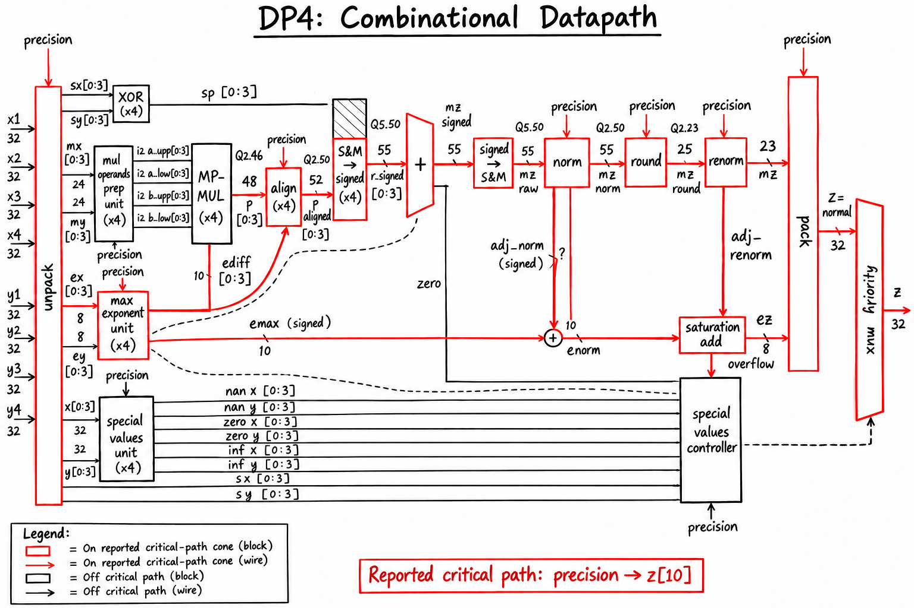

The combinational datapath computes four products and their sum using shared hardware for FP32 and FP16. The `precision` input selects FP32 (`0`) or FP16 (`1`); FP16 values occupy port bits `[31:16]`, and the unused lower input bits are ignored. Unpacking extracts the sign, exponent, fraction, and special-value flags. Normal operands receive a hidden leading one, while subnormals use a leading zero and an effective exponent field of one. This produces 24-bit FP32 or 11-bit FP16 significands.

Each lane builds its FP32 significand product from four unsigned 12×12 partial products. FP16 significands fit in the low halves, so their product uses only the low-low multiplier. The product exponent is calculated by summing the effective operand exponent fields and subtracting one format bias, 127 for FP32 or 15 for FP16, leaving a signed output-biased exponent. The maximum exponent among nonzero finite products sets the alignment reference. FP32 products have 46 fractional bits and FP16 products have 20; precision-dependent shifts place both on a shared Q2.50 grid before exponent alignment. Alignment truncates the unsigned magnitudes, which are then converted to signed Q5.50 values and summed through a balanced adder tree. This finite-width accumulation need not match an exact fused dot product after cancellation.

Normalization locates the leading one in the sum's magnitude and adjusts the exponent; gradual underflow right-shifts the significand with sticky-bit preservation. Rounding retains 24 significand bits for FP32 or 11 for FP16 and implements round-to-nearest, ties-to-even with `increment = G && (R || S || retained_LSB)`: values above halfway round upward in magnitude, while exact ties increment only when the retained least-significant bit is odd. Renormalization shifts a rounding carry and increments the exponent, or promotes a rounded subnormal to the smallest normal value, before packing the selected format.

The priority mux selects the first matching result below. Operand signs determine infinity-product signs; classification flags ensure exceptional operands take precedence over intermediate finite arithmetic.

| Priority | Condition | Selected Result |
|---|---|---|
| 1 | Any NaN operand, any zero-times-infinity product, or both positive and negative infinity products | Canonical quiet NaN. |
| 2 | Infinity products have only one sign | Infinity with that product sign. |
| 3 | The finite result's exponent overflows after rounding | Infinity with the accumulated result's sign. |
| 4 | The finite accumulated magnitude is exactly zero | Positive zero for cancellation; negative zero when all four products are zero and all product signs are negative. |
| 5 | Otherwise | Rounded finite result, including subnormals and signed zero from rounding a tiny nonzero result. |

### 3.2 Pipelined Organization ([`DP4_pipe.v`](rtl/DP4_pipe.v))

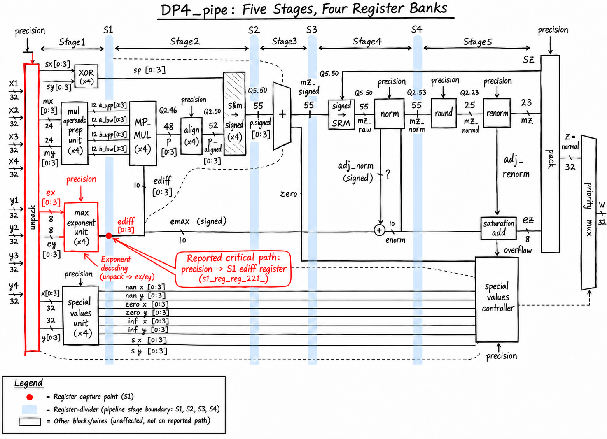

Four register banks divide the datapath into five stages, with four capture edges of latency and one new transaction per cycle. Precision, signs, and special-value metadata travel with each transaction through the pipeline.

| Stage | Arithmetic And Control | Output Boundary |
|---|---|---|
| 1 | Unpack operands, prepare significands, calculate product exponents, select the maximum exponent, and calculate alignment differences. | S1 registers |
| 2 | Multiply significands, align unsigned products, and convert them to signed fixed point. | S2 registers |
| 3 | Accumulate four products with a balanced signed adder tree. | S3 registers |
| 4 | Convert the sum to sign-magnitude, detect its leading one, normalize, and prepare subnormals. | S4 registers |
| 5 | Apply round-to-nearest, ties-to-even, renormalize, pack, and select the final result. | Combinational output |

### 3.3 Low Power Design With Clock Gating ([`DP4_CG.v`](rtl/DP4_CG.v))

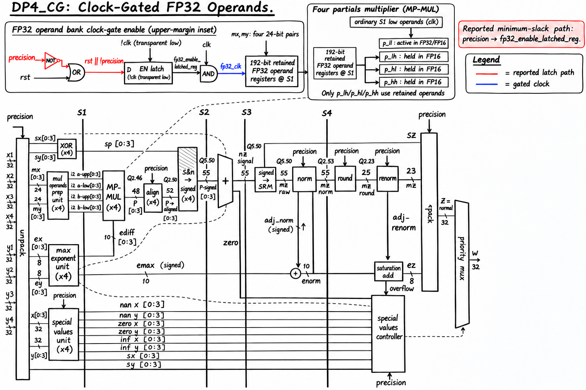

The [clock-gated pipeline](rtl/DP4_CG.v) uses the same arithmetic and four-capture-edge latency as the [pipeline baseline](rtl/DP4_pipe.v). Each 24-bit FP32 significand is split into upper and lower 12-bit halves, allowing multiplication through four partial products: low-low, low-high, high-low, and high-high. FP16 significands contain only 11 bits, so only the low-low product is needed. The other three partial multipliers in each of the four dot-product lanes can remain inactive. A dedicated 192-bit FP32 operand bank retains both operands for those three partial multipliers. This bank includes copies of the low halves as well as the upper halves: freezing only the upper halves would still allow changing FP16 low halves to toggle the cross-product multipliers. During FP16 transactions, the retained bank holds its previous values while the ordinary S1 operand path continues updating the low-low multiplier. The precision-controlled product selection ignores retained FP32 partial products; clock gating does not force stored operands to zero.

The bank uses a latch-based clock gate. While the clock is low, the enable latch follows `rst || !precision`; while the clock is high, it holds the enable stable. ANDing this latched enable with the clock prevents enable changes during the high phase from creating extra edges or truncating clock pulses. FP32 transactions enable operand capture, and synchronous reset opens the gate so the retained bank clears even in FP16 mode. Metadata and downstream pipeline registers continue using the ordinary clock, allowing FP32 and FP16 transactions to overlap without stalling.

The synthesis flow uses manual gating with `replace_clock_gates` and reports clock-gating elements for inspection. Gating reduces unnecessary register clocking and multiplier activity, but the shared low-low multiplier, downstream arithmetic, and product-combination logic can still switch.

<p align="center">
  <a href="images/ta_clock_gating_slide_9.png">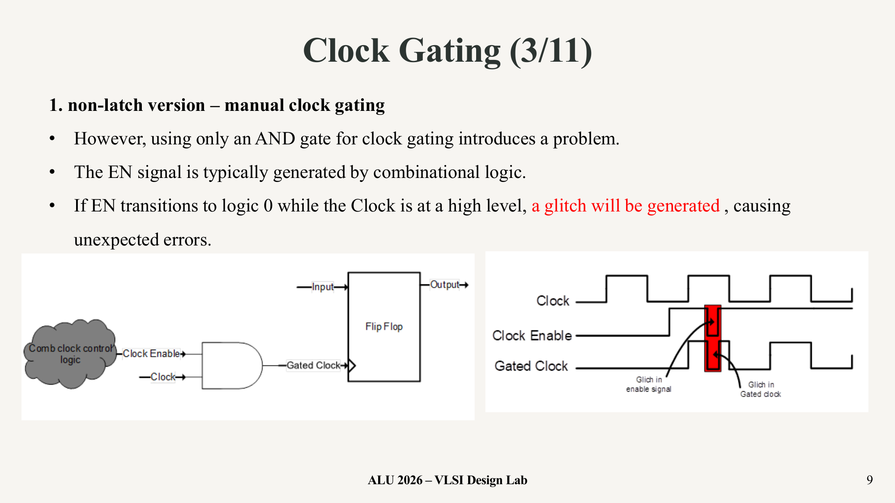</a>
  <a href="images/ta_clock_gating_slide_11.png">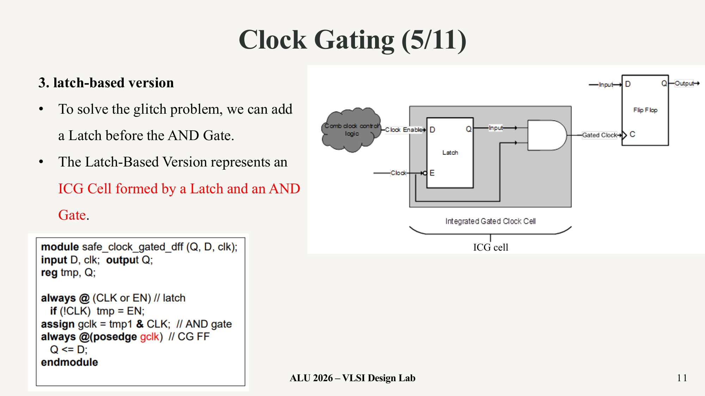</a>
  <a href="images/ta_clock_gating_slide_13.png">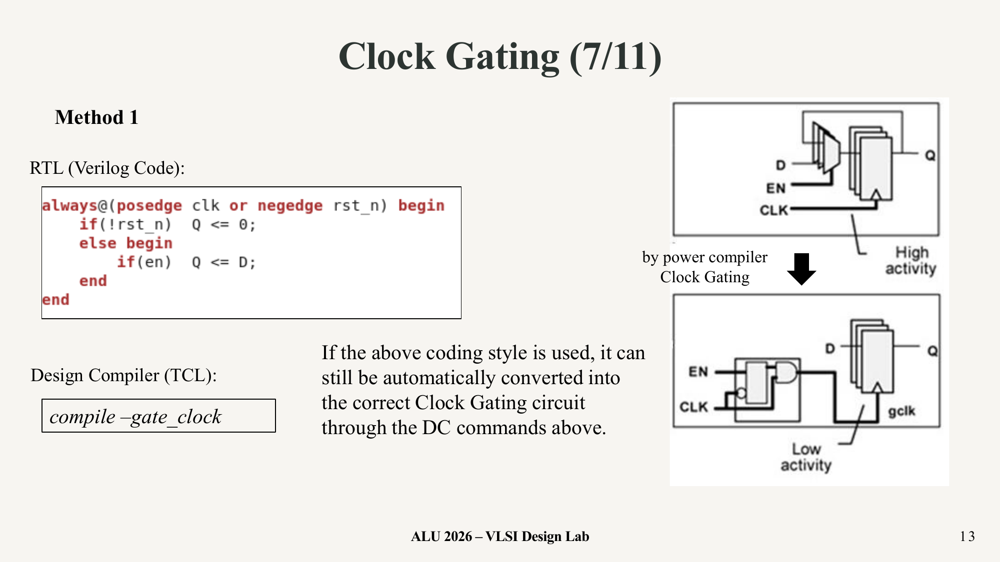</a>
  <a href="images/ta_clock_gating_slide_14.png">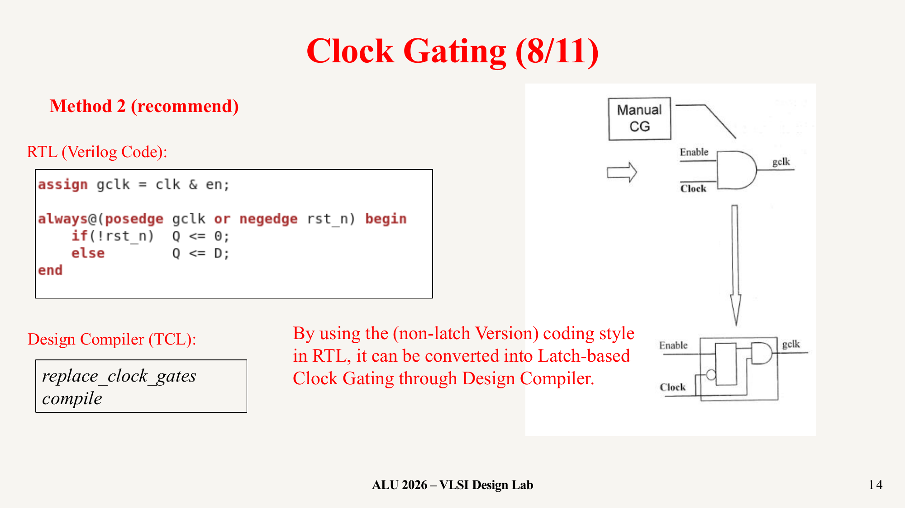</a>
</p>

## 4. Verification

The Python reference model in [`generate_vectors.py`](testdata/generate_vectors.py) generates expected results for the finite-width datapath, including alignment truncation, rounding, and special-value handling. RTL and gate-level simulation use the same vectors and comparison rules, with identical [RTL](rtl-sim/TB.v) and [gate-level](gate-level-sim/TB.v) testbench source files; compile-time options enable SDF annotation for gate-level runs. The testbench drives operands while the clock is low, retains each transaction's precision and expected result in a latency-aware scoreboard, and samples pipeline outputs half a period after the fourth capture edge; combinational outputs are checked half a period after input drive. Outstanding transactions are drained before reset checks and final result reporting. Gate-level verification additionally requires completed SDF annotation and no timing violations. See [Testbench Design](docs/testbench.md) for detailed timing and comparison rules.

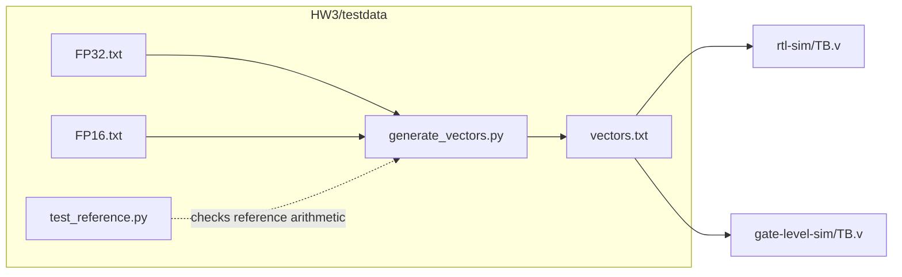

| Vector Variation | Purpose |
|---|---|
| Alternating FP32 and FP16 | Exercise precision changes between consecutive transactions. |
| Positive and negative operands | Exercise product signs and accumulation of terms with equal or opposing signs. |
| Zeros and signed zeros | Exercise zero products and signed-zero result selection. |
| Cancellation | Use opposing products to exercise near-zero and exactly zero accumulated results. |
| Different exponent ranges | Exercise alignment shifts and truncation of products with smaller exponents. |
| Subnormal operands and tiny results | Exercise hidden-bit handling, gradual underflow, and rounding near zero. |
| Rounding boundaries | Exercise values below, at, and above halfway points for round-to-nearest, ties-to-even. |
| Large finite values | Exercise overflow and result-exponent adjustment. |
| Infinity and NaN | Exercise exceptional-result priority, including zero times infinity and opposing infinity products. |
| FP16 inputs with nonzero unused bits | Verify that lower port bits do not affect the FP16 result. |

## 5. Power Analysis With PrimeTime PX (PTPX)

<p align="center">
  <a href="images/ta_power_analysis_slide_19.png">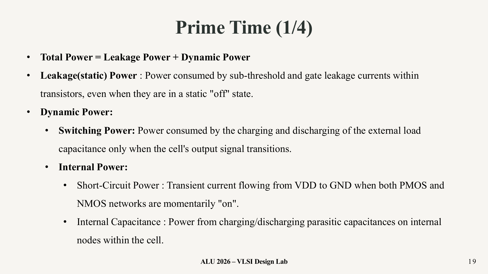</a>
  <a href="images/ta_power_analysis_slide_21.png">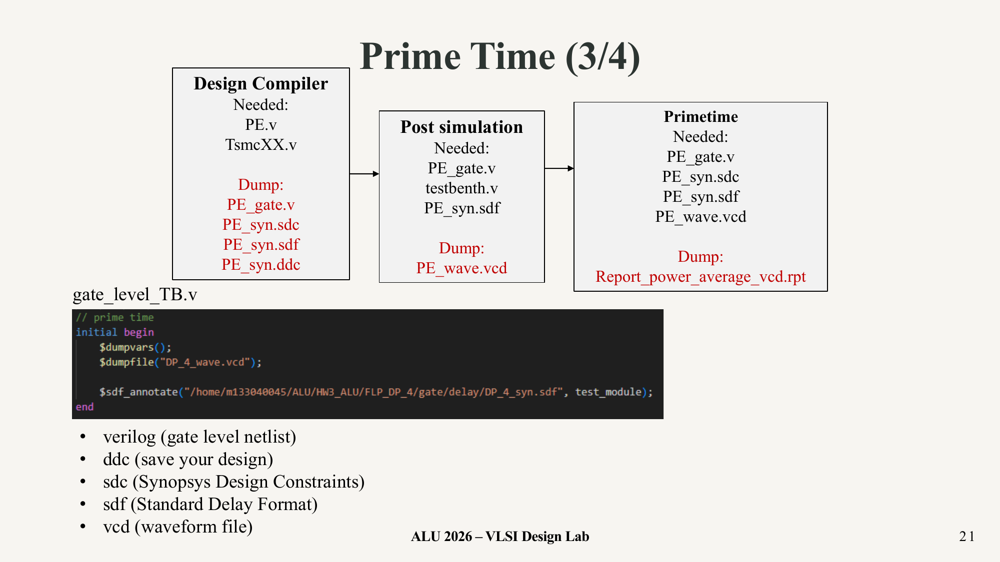</a>
</p>

Power is evaluated using both Design Compiler estimates and PrimeTime's activity-based averaged analysis. The [PrimeTime script](prime_time/pt.tcl) loads each synthesized netlist and its cell libraries, restores timing constraints and operating conditions from the SDC, and annotates timing delays from the SDF. It then reads the gate-level simulation VCD, mapping `testbench/dut` to the loaded design. This supplies switching activity from the same mixed FP32/FP16 workload used for functional verification. Unlike a synthesis estimate based on assumed activity, the VCD reflects simulated precision changes, gated-clock behavior, and internal signal transitions.

Total power combines cell internal power, net switching power, and leakage power. Clock gating primarily targets the dynamic components: internal power associated with clocking and computation, and switching power associated with charging and discharging connections. Leakage remains present when a clock is stopped and can increase because of the additional retained registers and gating circuitry. Averaged analysis reports consumption over the recorded simulation interval, including reset and pipeline filling and draining; it does not report instantaneous peak power or FP16-only consumption.

The separate [pipeline report](prime_time/report_power_pipe.rpt) and [clock-gated report](prime_time/report_power_CG.rpt) include units, input-file paths, and hierarchical power breakdowns. Isolating clock-gating savings requires verified activity annotation and comparison at the same clock period, operating conditions, and workload. Independently tuned operating points combine frequency differences with implementation differences. Synthesis-stage netlists also omit a routed clock tree and extracted interconnect parasitics, so these measurements characterize the course synthesis flow rather than final post-layout power.

## 6. Results

### 6.1 Area, Timing, And Power Comparison

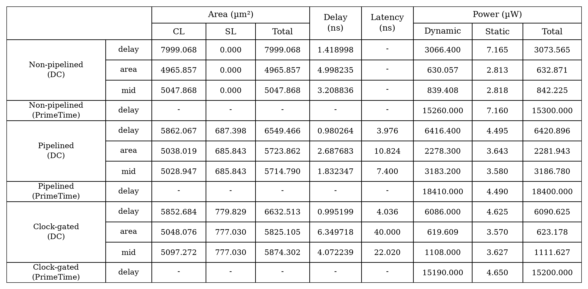

Delay is the reported DC arrival time, including launch-edge offsets; pipeline latency is four selected periods. PrimeTime dynamic power combines internal and switching power.

Sources: [DC summary](result/summary.csv) and PrimeTime reports for [`DP4`](prime_time/report_power_DP4.rpt), [`DP4_pipe`](prime_time/report_power_pipe.rpt), and [`DP4_CG`](prime_time/report_power_CG.rpt).

**Observations**:

- **Timing optimization trades area and power for speed.** For `DP4`, moving from area to delay optimization reduces reported arrival time from 4.998 to 1.419 ns, but increases cell area from 4,965.857 to 7,999.068 µm² and DC dynamic power from 630.057 to 3,066.400 µW. The trend is not strictly monotonic: `DP4_pipe`'s mid implementation is slightly smaller than its area implementation, at 5,714.790 versus 5,723.862 µm².
- **Pipeline area overhead depends on the timing target.** Under area optimization, `DP4_pipe` occupies 15.3% more area than `DP4`; under delay optimization, it occupies 18.1% less. Its delay-strategy period falls from `DP4`'s 2.838 ns to 0.994 ns, supporting a nominal transaction rate 2.86 times that of `DP4`, while its four-capture-edge latency is 3.976 ns. This improves throughput rather than necessarily shortening a single transaction's latency.
- **Clock gating trades extra storage for reduced activity.** Under delay optimization, sequential area rises from 687.398 to 779.829 µm². PrimeTime internal power falls from 10.5 to 8.79 mW and switching power from 7.91 to 6.40 mW, while leakage rises from 4.49 to 4.65 µW. Total reported power is approximately 17.4% lower, consistent with reduced activity at the cost of added circuitry.
- **Frequency differences limit attribution of power savings.** `DP4_CG`'s area-strategy period is 10 ns versus the pipeline baseline's 2.706 ns, so its lower power cannot be attributed to gating alone. Even the delay-strategy comparison uses 1.009 versus 0.994 ns; additionally, the `DP4_CG` delay simulation records 36 mismatches and timing violations, limiting the validity of that power comparison.
- **The DC–PrimeTime discrepancy is predominantly dynamic power.** For `DP4_pipe`, total power increases from DC's 6.421 mW to PrimeTime's 18.4 mW, while leakage stays close at 4.495 versus 4.49 µW. The close leakage estimates and larger dynamic-power difference are consistent with differing activity assumptions. The VCD includes mixed FP32/FP16 traffic; the available power reports do not establish which switching sources dominate the discrepancy.

### 6.2 Critical Paths And Pipeline Balance

Numerical values below are rounded to three decimal places; small positive slacks can therefore appear as 0.000 ns. The following paths have the lowest reported setup slack in each selected delay-strategy timing report. A minimum-slack latch path requires separate interpretation from a register-to-register arithmetic path.

Sources: selected [`DP4` timing report](syn/delay/DP4/DP4_timing_report.txt), [`DP4_pipe` timing report](syn/delay/DP4_pipe/DP4_pipe_timing_report.txt), and [`DP4_CG` timing report](syn/delay/DP4_CG/DP4_CG_timing_report.txt).

| Design | Reported Path Start → End | Arithmetic Section Or Stage | Timing Observation |
|---|---|---|---|
| `DP4` | `precision` → `z[10]` | Precision-dependent combinational input-to-output path | Arrival 1.419 ns; setup slack 0.000 ns. |
| `DP4_pipe` | `precision` → `s1_reg_reg_221_` | Stage 1 operand/exponent preparation and alignment-difference calculation | Arrival 0.980 ns includes the 0.497 ns falling-edge launch offset; setup slack 0.000 ns. |
| `DP4_CG` | `precision` → `fp32_enable_latched_reg` | Low-phase clock-enable latch associated with S1 | Arrival 0.511 ns; reported slack 0.000 ns with 0.006 ns of latch time borrowing. |

Pipeline inputs are launched on falling edges and captured at S1 on rising edges, giving half a period for the first stage. Register-to-register paths have a full period, while S4-to-output paths have half a period before the testbench sample. These unequal budgets mean that the number of arithmetic operations in a stage alone does not determine its timing margin.

The clock-enable latch's zero slack reflects time borrowing in the reported analysis and does not establish the minimum feasible period of the multiplier stage. The `DP4_CG` delay gate simulation reports setup/hold violations at S2 registers, despite nonnegative reported synthesis slack. Static timing results and annotated gate-simulation evidence must therefore be assessed together before treating the selected period as a verified operating point.

## 7. Future Improvements

Future work could rebalance the pipeline and refine timing constraints around the gated operand bank to address the setup/hold violations observed at the second-stage registers of `DP4_CG`. These violations coincided with output mismatches during gate-level simulation. After establishing passing operating points, comparing the pipeline and clock-gated implementations at a common frequency with identical workloads would better isolate clock-gating savings. Separate FP32-only, FP16-only, and mixed-precision measurements could reveal how mode transitions affect power, while post-layout analysis with extracted interconnect parasitics and a routed clock tree would provide more realistic timing and power estimates.

## 8. Conclusion

The three implementations show that the benefit of pipelining depends on the synthesis target. Under area optimization, `DP4_pipe` requires 15.3% more cell area than `DP4`, whereas under delay optimization it requires 18.1% less and reduces the selected period from 2.838 to 0.994 ns. This supports a nominal transaction rate 2.86 times that of `DP4`, but its four-capture-edge latency is 3.976 ns, so the throughput improvement does not imply lower latency for an individual dot product. Adding clock gating increases delay-strategy total area by approximately 1.3% relative to `DP4_pipe`; the PrimeTime reports show lower internal and switching power, with total power decreasing from approximately 18.400 to 15.200 mW while leakage increases slightly. The area and leakage increases quantify the overhead of the additional operand storage and clock-gating circuitry.

Although `DP4_CG` exhibited gate-level timing violations at the delay operating point, this homework demonstrated how arithmetic design, pipeline organization, and clock gating jointly influence area, timing, and power. Implementing shared FP32/FP16 hardware required consistent operand scaling, rounding, and special-value handling, while pipelining required control metadata to remain aligned with each transaction. The clock-gating implementation showed that suppressing unnecessary multiplier activity depends on retaining both operands and generating a stable gated clock. Comparing DC and PrimeTime results also highlighted the importance of workload-dependent switching activity when evaluating power. Matching constraints to testbench timing, verifying annotated gate-level behavior, and comparing implementations under identical operating conditions are the best practices going forward.
