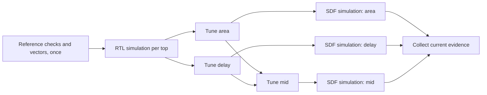
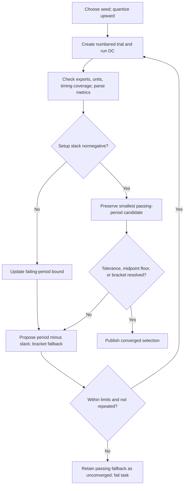

# HW3 Automation Framework

See [files and usage](files_and_usage.md) for the project layout, important files, and log locations.


## Entry point and CLI

Examples assume the working directory is `HW3/`. `$ ` is a documentation prompt,
not part of the executable command. The launcher also works from another directory
when invoked through its correct relative or absolute path.

```sh
$ bash run.sh --help
$ bash run.sh DP4 pre
$ bash run.sh DP4_pipe synth delay --period 20
$ bash run.sh DP4_pipe tune all --jobs 2
$ bash run.sh DP4_CG post delay
$ bash run.sh all all --jobs 3
$ bash run.sh collect
```

| Argument | Choices / behavior |
|---|---|
| Target | `DP4`, `DP4_pipe`, `DP4_CG`, `all`, or `collect`. |
| Action | `pre`, `synth`, `tune`, `post`, `all`; defaults to `all`. |
| Strategy | `area`, `mid`, `delay`, `all`; defaults to `all`. Not used by `pre`. |
| `pre` | Check reference, regenerate vectors, compile and simulate RTL. |
| `synth` | One fixed-period synthesis per selected strategy; require passing setup timing. |
| `tune` | Search synthesis periods and publish converged selections. |
| `post` | Regenerate/check vectors, then verify existing synthesis selections with SDF. |
| `all` | Reference checks → RTL simulation → tuning → gate simulation. |
| `collect` | Read evidence and regenerate CSV without launching EDA tools. |

Explicitly tuning `mid` also tunes its area/delay prerequisites. `tune all` covers
all three strategies. Standalone `synth mid` is a fixed-period run and does not
calculate a midpoint. `all` does not silently skip existing skeleton `.v` files;
they are failures that must be implemented before EDA execution can succeed.

| Option | Default | Meaning |
|---|---|---|
| `--jobs N` | `1` | Maximum simultaneous tasks/tool processes. |
| `--period NS` | `20` | Target for fixed-period `synth`. |
| `--cycle NS` | RTL: `20`; gate: selected period | Optional simulation-clock override. |
| `--area-seed NS` | `10` | Area search starting period. |
| `--delay-seed NS` | `0.01` | Delay search starting period. |
| `--resolution NS` | `0.001` | Period grid and minimum search period. |
| `--tolerance NS` | `0.005` | Accepted nonnegative setup-slack tolerance. |
| `--max-attempts N` | `20` | Per-strategy search attempt limit. |
| `--max-period NS` | `1000` | Upper search-period bound. |

All periods must be finite and positive; slack tolerance may be zero. Override
the course library location with `CELL_LIB_DIR` and the cell simulation model
with `HW3_CELL_MODEL`. By default both use the supplied N16ADFP course paths.

## Dependencies and concurrency



Each top has independent branches. A failed task skips its dependents while
unrelated tasks continue; the overall invocation fails if anything fails or is
skipped. A project-wide `flock` prevents two launcher invocations from publishing
into the same destinations. `--jobs` bounds work inside the locked invocation.
Use the launcher rather than calling `workflow.py` directly to retain this lock.

Stage transcripts and build directories live beside their stages:

| Stage | Transcript | Temporary Work |
|---|---|---|
| Reference | `testdata/run.log` | No persistent build directory. |
| RTL simulation | `rtl-sim/<top>/run.log` | `rtl-sim/<top>/work/` |
| Synthesis | `syn/<strategy>/<top>/run.log` | `tune/001_period_10ns/`, followed by numbered trials. |
| Gate simulation | `gate-level-sim/<strategy>/<top>/run.log` | `work/` beneath that directory. |

Each stage log includes its launcher command, progress, command output, and final
status. Parallel workers are routed independently. Requested stage logs are reset
before scheduling and skipped stages record `SKIP`; other stages' logs remain.
Compile, simulation, JSON, and waveform files live directly in each design directory.
The combined DC transcript and selected exports live in the synthesis design directory.
`result/` holds only the aggregate CSV, latest task-state JSON, and lock. There is
no combined invocation log; `collect` prints to the terminal without stage logs.
Legacy generated folders are left untouched and are no longer used.

SIGINT/SIGTERM cancel the coordinator's child process groups. Children that ignore
termination receive a forced kill after five seconds. Already completed unrelated
outputs remain available; interrupted records do not become successful results.

## Period tuning and DC



For area, DC adds `set_max_area 0`; mid and delay use their timing constraints
without that area target. Mid starts at the mean of selected area/delay periods
and does not go below it. An inverted area/delay pair is rejected for inspection.
The heuristic does not prove globally minimum area or delay, and synthesis can
be nonmonotonic as netlists change.

DC keeps the HW1 SS/FF libraries, operating corners, ZeroWireload model, naming
rules, and Verilog/DDC/SDF 2.1/SDC formats. `DP4` uses a virtual clock;
pipelines use physical `clk`. Zero input delay and half-period output delay
leave a half-period input-to-output budget for `DP4`, without an additional
`set_max_delay` constraint. Both use a half-period output budget,
matching the testbench sample point. Internal register paths retain a full period.
Pipeline input delays reference the falling clock edge with `-clock_fall`,
matching the testbench's input drive edge. This allows half a period from the
inputs to S1, a full period between register banks, and half a period from S4
to the outputs. `DP4` retains rising-edge virtual-clock input timing.
Reset is case-analyzed low for timing,
while precision remains unconstrained. `DP4_CG` runs `replace_clock_gates` before
`compile` and emits a clock-gating report. Confirm actual ICG mapping from that
report after implementing a compatible RTL gating style.

The authoritative Tcl explicitly sources `.synopsys_dc.setup` relative to itself.
It accepts `TOP`, `SYN_CONFIG`, and `PERIOD_NS`; automation also provides validated
`HW3_OUT` and `HW3_RTL_LIST`. DC accepts launcher output only at
`syn/<strategy>/<top>/tune/<index>_period_<period>ns/`. Optional `rtl/files.txt` lists project-relative `.v`
sources under `rtl/` in analysis order. Without it, the runner analyzes the chosen
top plus shared `.v` helpers, excluding the other two tops. No SystemVerilog option
is enabled. Add a manifest when one top depends on another top's file.

Each trial retains its complete DC files, `trial.json`, and `synth.log`.
Names such as `001_period_10ns` and `002_period_8.5ns` preserve execution order.
The stage-level `synth.log` combines all trial transcripts; `search.json` lists
their paths, statuses, and metrics. `selected.json` points to the selected trial,
whose exports and reports are copied into the design directory. A new synthesis
invocation resets only its requested `tune/` before scheduling. Fixed-period
synthesis also uses `tune/`, with one trial. There are no attempt/best copies. Tool errors fail the task; exhausted or repeated search periods retain
any available fallback with `converged=false`. Post-simulation rejects such fallbacks.
Stage timing is not inferred from nonexistent register names; only overall timing
is collected until actual pipeline boundaries are available.

## Simulation evidence and stale-result rejection

The runner supplies `DUT_MODULE`, `DUT_LATENCY` (0 or 4), and `TB_PERIOD` at compile
time, then passes absolute `+VECTORS`, `+RESULT`, and `+VCD` paths at runtime.
Gate compilation defines `HW3_GATE_SIM` and a quoted `HW3_SDF_FILE` path so
VCS sees a literal filename in `$sdf_annotate`; RTL builds omit annotation code.
The runtime `+SDF` path must match the compiled filename.
Gate simulation receives `+GATE` and `+SDF`; maximum SDF values are requested.
VCS requires the annotation log argument to be a literal, so the bench writes
`sdf_annotation.rpt` in its isolated work directory. The runner copies that file
to the per-top/strategy annotation report before validating it. Build outputs and
native scratch files are isolated under work.

The testbench drives falling edges and samples half a period after the
relevant edge. Pipeline checks finish before the next input is driven on that
same falling edge, preserving one transaction per cycle. Combinational checks
occur half a period after input drive. Its JSON completion record is emitted
only after normal end-of-file
processing and pipeline draining. The runner checks all vector comparisons plus
the scheduled reset checks, zero errors, correct latency/period, final PASS, and
a nonempty VCD. An early `$finish` cannot reuse an old completion record.

Gate simulation must also have a completed SDF annotation report, zero annotation
errors, classified warnings, and no timing violations. Only the HW2 connectivity
warnings `SDFCOM_SWC` and `SDFCOM_IWSBA` are accepted, and their report text must
explicitly confirm delay annotation still occurs. Unknown diagnostics fail closed.

SHA-256 records cover sources, synthesis settings/scripts, testbenches, reference
helpers, input/golden files, exports, waveforms, and the standard-cell simulation
model. Changed dependencies make earlier evidence stale. Library-directory settings
are fingerprinted; external `.db` library contents are not copied or hashed.

A slower `--cycle` can establish functional correctness at that period, but is
labeled `passed_other_period` and cannot yield verified status for the selected
synthesis period. The default gate clock is the selected period, unlike HW2's
independent slow checker cycle.

## Summary and troubleshooting

| CSV field | Meaning |
|---|---|
| `comb_um2`, `seq_um2`, `total_um2` | DC combinational, sequential, and total cell area. |
| `delay_ns` | Largest reported nonnegative data arrival time, following the course reporting convention. |
| `period_ns`, `slack_ns` | Selected target period and worst reported setup slack. |
| `latency_cycles`, `latency_ns` | Pipeline capture-edge count and count × selected period; combinational time latency is blank. |
| `dynamic_uw`, `leakage_uw`, `power_uw` | DC estimated power in µW; unavailable fields remain blank. |
| `converged`, `synthesis_status` | Search/selection state. |
| `pre_status`, `post_status`, `status` | Verification evidence; verified requires current converged synthesis and both checks at their required settings. |

JSON/CSV retain numeric precision; power is not rounded to three decimal watts.
`delay_ns × stage count` is not presented as measured pipeline latency. Simulation
checks timing and functions under the chosen constraints; these results are not
post-route timing or hardware validation.

| Symptom | Next check |
|---|---|
| Skeleton error | Implement the RTL; do not remove the marker to synthesize an empty circuit. |
| Missing tool/library | Load server tools; check `PATH`, `CELL_LIB_DIR`, and `HW3_CELL_MODEL`. |
| Missing or stale selection | Rerun synthesis/tuning for that top and strategy. |
| Timing search does not converge | Inspect search JSON and synthesis log; adjust bounds/seeds or improve RTL. |
| Gate FAIL or SDF diagnostics | Inspect simulation log, annotation report, sampling period, and DUT latency. |
| Missing completion record | Simulator exited early, watchdog fired, file access failed, or TB did not finish. |
| Another workflow is running | Wait for the lock owner; an idle lock file can remain safely. |

## Manual PrimeTime and local framework checks

The launcher never invokes PrimeTime. After a matching gate simulation, run:

```sh
$ TOP=DP4_pipe SYN_CONFIG=delay pt_shell -f prime_time/pt.tcl
```

The manual script reads `syn/delay/DP4_pipe_syn.*` and
`gate-level-sim/DP4_pipe_delay_wave.vcd`, strips `testbench/dut`, and overwrites
`prime_time/report_power.rpt`. Select the same top/strategy used to create the VCD.
It checks file presence but does not enforce the Python provenance manifest;
review the verification record before manual analysis. External libraries remain
external. Review timing/activity coverage and keep DC estimates distinct from
PrimeTime's VCD-based measurements. A 50/50 transaction workload is not exactly
50/50 elapsed activity time because reset and drain cycles are additional.

Local framework tests require Python, not EDA licenses:

```sh
$ python3 -B scripts/test_workflow.py
$ python3 -B testdata/test_reference.py
```

The framework tests fabricate tool outputs in temporary projects. They check
scheduling, tuning, transcripts, stale evidence, overwrite behavior, cleanup,
and parsers; they do not establish VCS command compatibility, SDF coverage on a
real netlist, functional RTL correctness, clock-gating effectiveness, or PPA.
