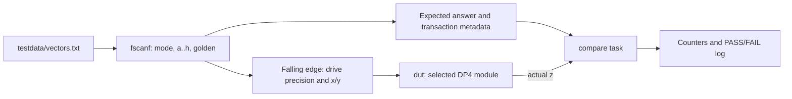
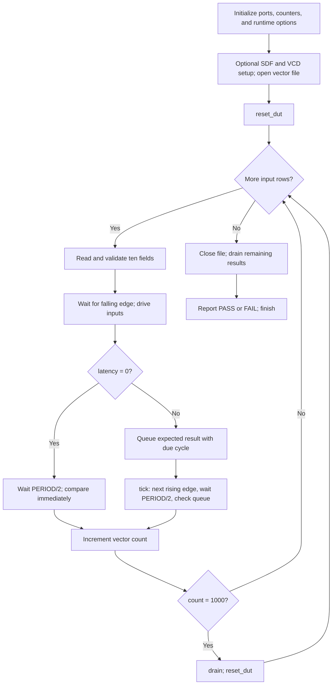
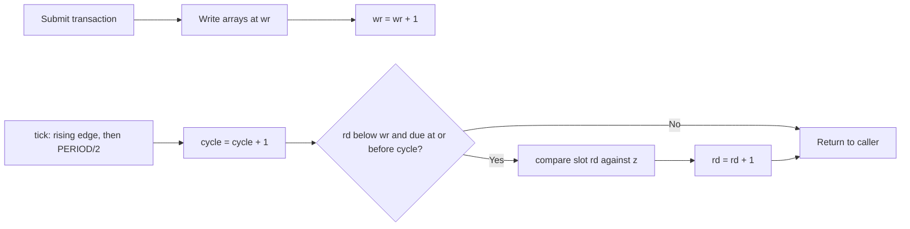
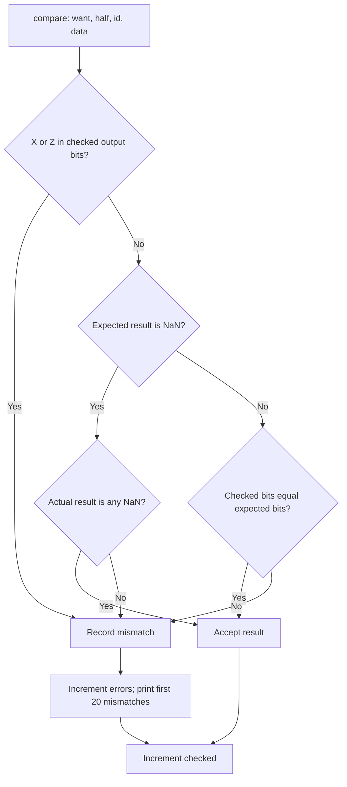

# Understanding TB.v

The [RTL testbench](../rtl-sim/TB.v) and [gate-level testbench](../gate-level-sim/TB.v) contain the same code. Each reads expected answers from [vectors.txt](../testdata/vectors.txt), drives the selected DUT, and checks `z`. Finite-width architectural reference arithmetic runs in Python before simulation; it is not calculated inside `TB.v`.

## 1. Start with the data flow



Each input row has ten fields:

```text
precision  x1 x2 x3 x4  y1 y2 y3 y4  expected_z
```

| Parsed name | Meaning |
|---|---|
| `mode` | Decimal `0` for FP32 or `1` for FP16; drives `precision`. |
| `a, b, c, d` | Hexadecimal words that drive `x1, x2, x3, x4`. |
| `e, f, g, h` | Hexadecimal words that drive `y1, y2, y3, y4`. |
| `golden` | Expected output bits from the Python reference. |

FP16 operands and expected results occupy bits `[31:16]` of their 32-bit words.

## 2. Configuration at the top of the file

| Setting | Default | Purpose |
|---|---|---|
| `DUT_MODULE` macro | `DP4` | Names the module instantiated as `dut`. |
| `DUT_LATENCY` macro | `0` | Initializes parameter `DEFAULT_LATENCY`. Define it as `4` for the five-stage datapath with four internal register banks. |
| `PERIOD` parameter / `TB_PERIOD` macro | `20.0` ns | Clock period; clock toggles every `PERIOD/2`. |
| `+LATENCY=N` | Compiled default | Overrides output latency at runtime. |
| `+VECTORS=path` | `HW3/testdata/vectors.txt` | Selects the stimulus/expected-output file. |
| `+GATE` and `+SDF=path` | Disabled | Enable the gate-level path and annotate delays onto `dut`. Both must be supplied together. |
| `+RESULT=path` | Disabled | Writes structured completion counts after normal completion. |
| `HW3_GATE_SIM` macro | Undefined | Compile SDF support for gate runs; annotation writes literal `sdf_annotation.rpt` in the simulation working directory. |
| `+VCD=path` | Disabled | Dumps waveforms for inspection or PrimeTime activity analysis. |

For a pipeline, define **both** `DUT_MODULE` and `DUT_LATENCY`. Selecting a module does not automatically change latency. There is no `valid` or `ready` port: the scoreboard assumes fixed latency and one result per clock during continuous traffic.

The default vector path assumes simulation starts from the directory containing `HW3/`. Use `+VECTORS=...` when launching elsewhere. See [automation.md](automation.md) for compile settings and workflow commands.

## 3. Main simulation flow



Missing files, malformed rows, invalid precision, excessive queue usage, invalid latency, and an empty workload terminate with a `FAIL` message. The parser checks field count and precision; it is not a complete validator of arbitrary golden-output bit patterns.

Three processes run concurrently:

- The `always` block generates the clock.
- The main `initial` block reads vectors and calls the tasks above. `drive_phase` waits for a falling edge only when the clock is high; after a pipeline check, it reuses the current falling edge.
- A second `initial` block stops simulation after `PERIOD * 200000` with a watchdog failure.

Task calls such as `tick` block the calling process until their timing controls complete. The clock continues to run while the main process waits.

## 4. How the scoreboard aligns pipeline results

The scoreboard is a set of parallel arrays indexed by transaction slot. `wr` points to the next slot to write; `rd` points to the next result to check. The arrays have 65,536 slots and do not wrap around.

| Array | Stored information |
|---|---|
| `expected[slot]` | Expected result (`golden`). |
| `modes[slot]` | This transaction's precision, even if the current DUT input mode has changed. |
| `ids[slot]` | Zero-based input-vector index for diagnostics. |
| `operands[slot]` | Concatenation `{a,b,c,d,e,f,g,h}` for failure reports. |
| `due[slot]` | Cycle at which the output must be checked: `cycle + latency`. |



For example, suppose `cycle = 10` when inputs are driven and `latency = 4`. The queue stores `due = 14`:

| Event | Cycle after `tick` | Action for this transaction |
|---|---|---|
| First rising edge after drive | 11 | S1 captures unpacking and operand preparation. |
| Second rising edge | 12 | S2 captures multiplication, alignment, and signed conversion. |
| Third rising edge | 13 | S3 captures the signed sum. |
| Fourth rising edge | 14 | S4 captures normalization; compare after PERIOD/2 for final rounding and packing. |

`tick` checks at most one queued result per call. It returns at the falling edge; `drive_phase` reuses that edge after comparison rather than waiting another full cycle. With fixed latency and one submission per cycle, one check per cycle is sufficient. Four register banks divide the datapath into five combinational stages; the testbench observes only ports, not internal registers.

For `latency = 0`, no scoreboard entry is created. The testbench checks `z` after a settling delay following the falling-edge input change, then increments the cycle counter without calling `tick`. The next input is driven on the following falling edge.

## 5. What compare and is_nan check



`half` is the saved precision of the result being checked:

- FP32 checks all 32 bits of `z`.
- FP16 checks only `z[31:16]`; lower bits are ignored.
- Expected NaN accepts any actual NaN payload and sign in the selected format.
- Other results require exact bit equality, including signed zero. No numerical tolerance is applied.

`is_nan()` recognizes an all-ones exponent and a nonzero fraction. The reduction-XOR checks in `compare` detect unknown/high-impedance output bits before NaN or equality checks.

`checked` counts both vector comparisons and pipeline-reset comparisons. `count` counts only input rows. Therefore they need not match. Failure logs include the vector ID, cycle, precision, all eight operands, expected result, and actual result.

## 6. Reset and pipeline draining

`drain()` repeatedly drives zeros at falling edges and calls `tick()` until `rd == wr`. Those zero inputs are not queued; the purpose is to let previously submitted results reach the output.

`reset_dut()` asserts `rst` on a falling edge, drives zero inputs, calls `tick()` twice, and deasserts reset on a later falling edge. Reset therefore spans at least two complete cycles. When `latency > 0`, it also calls `compare(0, 0, -1, 0)` to check the full output is zero; ID `-1` denotes this reset check. It does not inspect internal pipeline registers directly.

Before its initial reset, the pipeline test fills all four banks with NaN traffic, then resets while that traffic is in flight. The test resets again after 1,000 vectors, draining queued comparisons first. Thus the first reset checks clearing live metadata and arithmetic, while the second checks reset between scored traffic blocks. `cycle`, `wr`, and `rd` continue across the second reset.

## 7. Gate-level hooks and completion

The instance name is always `dut`, regardless of the selected module. Gate builds define `HW3_GATE_SIM` and use `$sdf_annotate(sdf_path, dut, , "sdf_annotation.rpt", "MAXIMUM")`. VCS requires this log argument to be a literal string. The [runner](../scripts/workflow.py) copies the work-directory report to the published top/strategy report path before validation. RTL builds exclude the annotation call and reject gate-only runtime options. `$dumpvars(0, testbench)` includes the hierarchy `testbench/dut`, matching the strip path in [pt.tcl](../prime_time/pt.tcl).

At end-of-file, the main process closes the file and drains the pipeline. With `+RESULT=path`, it writes a JSON completion record containing status, vector/check/error counts, latency, reset checks, and period. The runner removes earlier completion records before rerunning and validates the new record in addition to the console log. It prints `PASS` only when the workload is nonempty and `errors == 0`. Verilog-2001 `$finish` does not provide a portable failure exit status, so automation must check for a final `PASS` and the absence of `FAIL` messages.

All three tops are implemented and included in the [local RTL regression](../scripts/test_rtl.py). Clock-gating checks also verify held operands, quiet unused partial multipliers, and reset while in FP16 mode. Expected vectors model Q2.50 alignment truncation and Q5.50 accumulation, not exact fused arithmetic. Reference-model checks alone do not establish RTL correctness. Gate-level verification also requires reviewing SDF annotation coverage and timing violations; VCD generation alone does not prove that delays were applied correctly.
